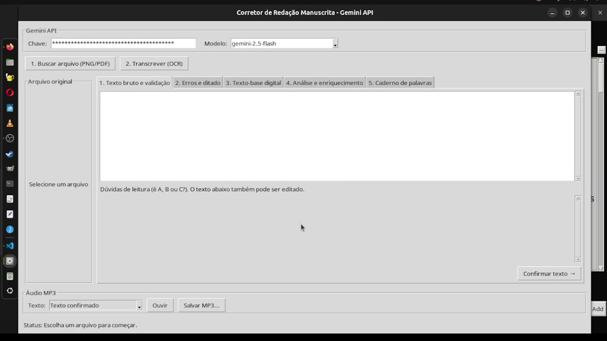
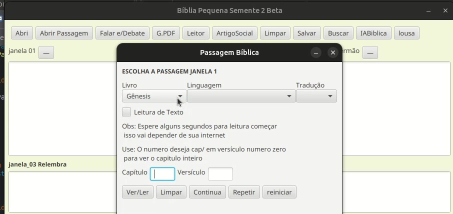
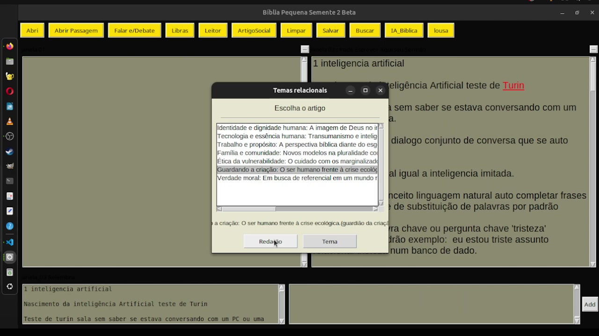
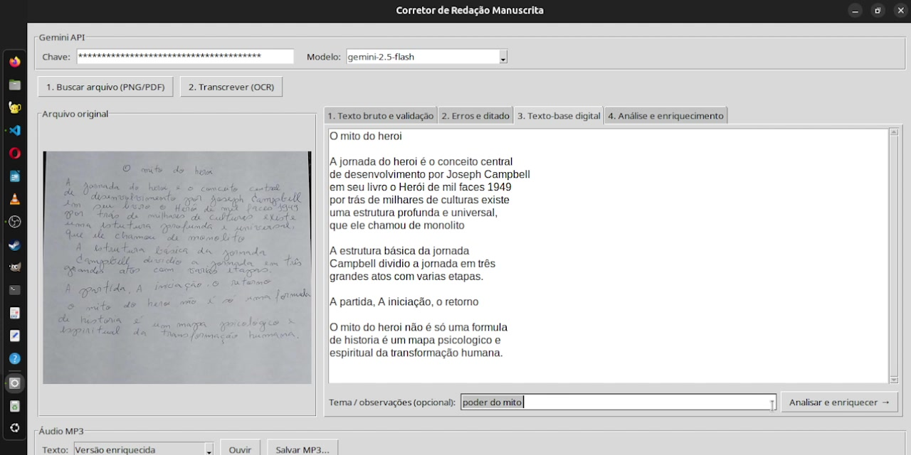

<div align="center">

# 🌱 Pequena Semente — Project Overview

**Bible-reading & sermon-writing platform with AI features — designed, built and operated end-to-end by a single developer since 2019.**

*This is a public overview of the project. The source code is kept private and is available upon request.*
**Na apresentação: mostra o projeto. Código-fonte: privado, sob solicitação do link.**

</div>

---

## ✨ About (English)

**Pequena Semente** ("Little Seed") is a Bible-reading and sermon-writing platform I have developed and operated myself **since 2019**. It started **without AI**: it grew first as a classic application (desktop + server + database). The AI layer — Gemini-powered features, an AI-mediated debate chat and server-side voice synthesis — was incorporated in later iterations, as the product matured.

### Platform capabilities

| Area | What it does |
|---|---|
| 📖 **Bible study** | Verse navigation (book/chapter/verse, multiple translations), reading flows and study boards |
| ✍️ **Sermon writing** | Multi-pane sermon editor with drafts and revision |
| 🤖 **AI features** | AI-driven study insights, AI-mediated debate chat, **handwritten essay transcription** (Gemini OCR + correction) |
| 💬 **Real-time chat** | Chat rooms with auto-expiration on inactivity, JWT authentication |
| 🔊 **Voice synthesis** | Server-side TTS with **Piper**, backed by a serial queue (one generation at a time) |
| 📚 **Essay correction** | Handwritten → digital text pipeline with narration/audio export (MP3) |
| 🏛 **Community management** | Member management, notifications and reports for congregations |
| ♿ **Accessibility** | Libras (Brazilian Sign Language) integration for Bible content — see project videos below |
| 🛡 **Ops** | Ubuntu servers on Oracle Cloud, Nginx + HTTPS (Let's Encrypt), Docker, firewall (ufw/iptables), backups |

### Architecture

```
                ┌──────────────────────────────────────────────┐
                │        Ubuntu server — Oracle Cloud          │
                │                                              │
 Web client ───▶│  Nginx (reverse proxy, HTTPS/Let's Encrypt)  │◀─── Desktop
 Desktop      ─▶│        │                                     │     client
                │        ▼                                     │
                │  ┌─────────────────────┐  ┌───────────────┐  │
                │  │  Java/Spring Boot   │  │ Python/FastAPI│  │
                │  │ · REST API          │  │ · Gemini AI   │  │
                │  │ · Spring Security   │  │ · Piper TTS   │  │
                │  │   + JWT             │  │   (serial     │  │
                │  │ · WebSocket chat    │  │    queue)     │  │
                │  └─────────┬───────────┘  └──────┬────────┘  │
                │            ▼                     ▼           │
                │      PostgreSQL / MariaDB   Docker / Ollama  │
                └──────────────────────────────────────────────┘
```

## 🇧🇷 Sobre (Português)

Plataforma de **leitura bíblica, escrita de sermões e gestão para comunidades** em evolução contínua **desde 2019** — começou **sem IA**, como aplicação clássica (desktop + servidor + banco de dados), e ganhou camada de IA em iterações posteriores (recursos com Gemini, chat mediado por agente, síntese de voz).

Toda a operação é minha: banco de dados, chat em tempo real, filas, TLS, firewall e backups — nos meus próprios servidores Ubuntu na Oracle Cloud.

## 🖼 Screenshots

<div align="center">

**Bíblia Pequena Semente — janela principal**



**Seleção de passagem bíblica** &nbsp;•&nbsp; **Busca de temas relacionados**

 

**Corretor de Redação Manuscrita — Gemini OCR + correção + narração MP3**



</div>

## 📌 Project history

- **2019** — project begins: platform focused on Bible reading and sermon writing
- **Since then** — continuously maintained and deployed on my own servers (7+ years in operation)
- **Later iterations** — AI layer added: Gemini-powered insights, AI-mediated chat, Piper TTS narration, handwritten essay pipeline

> 🔒 **Source code:** kept in a private repository. Happy to walk through architecture, code or a live demo on request.

## 🎬 Demo videos (YouTube — @AmigoPython)

A project like this is easier to *watch* than to describe — the channel documents its evolution year by year:

| Video | What it shows |
|---|---|
| [Pequena Semente em Java](https://www.youtube.com/watch?v=AqmQMZ5ek9M) | Latest JavaFX client demo (recent build) |
| [Criado a parte de Debate do projeto Pequena Semente](https://www.youtube.com/watch?v=IBbuKoonuo8) | The debate chat (where the AI agent mediates) |
| [Colocamos uma lousa é fizemos um servidor de chat](https://www.youtube.com/watch?v=4dOGT8f3U4c) | Chat server + teaching board |
| [Apresentação01 de como esta o projeto 2026](https://www.youtube.com/watch?v=pzRfLpmuyh4) | Full project tour (2026) |
| [Andamento Do Projeto Bíblia com Libras](https://www.youtube.com/watch?v=ObWvDXQgmrU) | Libras accessibility feature |
| [projeto java](https://www.youtube.com/watch?v=WpHDzW7DQNA) · [Janela Com Banco De Dados Em Java](https://www.youtube.com/watch?v=xe0Cmex6vaE) | Early Java/data layer phase (2023) |

📺 Full channel: [youtube.com/@amigopython8254](https://www.youtube.com/@amigopython8254)

## 👤 Author

**Jose Alfredo** — backend developer · Java/Spring Boot · Python/FastAPI · applied AI · Linux/Cloud
GitHub: [@chandocan](https://github.com/chandocan) · LinkedIn: [alfredo-santos-filho](https://www.linkedin.com/in/alfredo-santos-filho-2b467b127)
